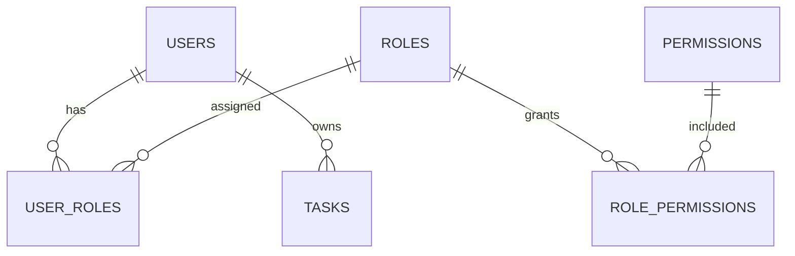

# 澄序 · 智能任务工作台（Task Studio）RBAC 技术设计

**状态：待确认，本文不包含业务实现。** 适用范围：Flask ≥ 3.0、Flask-SQLAlchemy ≥ 3.1、SQLite、原生 HTML/CSS/JS。沿用应用工厂、同源 SPA 和现有 LLM 调用，不引入前端框架、JWT、Redis 或额外权限服务。

现状：[应用工厂](app.py#L32) 只调用 `db.create_all()`；[对话](app.py#L53) 按传入 ID 直接查任务，[今日建议](app.py#L94) 读取所有未完成任务，[批量保存](app.py#L139) 尚未写归属。所有任务入口必须在同一次发布中切换到统一策略，不能只保护页面按钮或普通 CRUD。

**一期决策**：注册用户固定为 `member`，开放注册由配置开关控制（本地启动默认开启、服务部署默认关闭）；`viewer` 仅可读自己名下的任务，没有任何 AI 调用权限。管理员可把任务转到指定有效用户名下（包括 `viewer`），但一期不支持公开任务、多人共享、团队或细粒度授权列表。管理员在 CRUD 中管理全库，今日建议默认仍只给管理员推荐其自己的任务；跨用户 AI 输入需要明确触发。

## 1. 数据库 ER 与 SQLAlchemy 模型

复用 [现有 SQLAlchemy 实例与 UTC 时间工具](models.py#L1)。下面字段使用 `db.Column` 风格即可；`NN` 表示 `nullable=False`，默认建议同时设置适当的数据库默认值，以便原生迁移 SQL 与 ORM 一致。时间戳全部以 UTC 写入，JSON 使用 ISO 8601，兼容 SQLite 读出无时区值的现有处理。

| 模型 / 表 | 字段与约束 |
| --- | --- |
| `User` / `users` | `id Integer PK`；`username String(32) NN UNIQUE`，输入 `strip().lower()` 后匹配 `^[a-z0-9_]{3,32}$`，仅存规范值；`password_hash Text NN`；`is_active Boolean NN DEFAULT true`；`session_version Integer NN DEFAULT 1 CHECK >= 1`；`created_at`、`updated_at` 为 `DateTime(timezone=True) NN`。 |
| `Role` / `roles` | `id Integer PK`；`code String(32) NN UNIQUE`（`admin/member/viewer`）；`name String(64) NN`（中文显示名）；`description String(255)`。一期仅内置角色，不做运行时增删改。 |
| `Permission` / `permissions` | `id Integer PK`；`code String(64) NN UNIQUE`（如 `task:read`）；`description String(255)`。权限字典由服务端维护。 |
| `user_roles` | `user_id Integer NN FK users.id ON DELETE CASCADE`；`role_id Integer NN FK roles.id ON DELETE CASCADE`；联合主键 `(user_id, role_id)`；反向索引 `(role_id, user_id)` 用于按角色找用户和检查最后一个管理员。 |
| `role_permissions` | `role_id Integer NN FK roles.id ON DELETE CASCADE`；`permission_id Integer NN FK permissions.id ON DELETE CASCADE`；联合主键 `(role_id, permission_id)`；反向索引 `(permission_id, role_id)`。 |
| `Task` / `tasks` | 保留 `id/title/description/completed/created_at/updated_at` 及原 ID、字段值；最终新增 `owner_id Integer NN FK users.id ON DELETE RESTRICT`，**无默认值**。`Task.owner` / `User.tasks` 使用 `back_populates`，不配置删除用户时联动删除任务。 |

- `User.roles`、`Role.permissions` 用 `secondary` 声明双向关系；两张关联表直接用 `db.Table`，不额外造实体类。用户接口不传输 `password_hash`、`session_version` 或算法参数。任务响应沿用原字段，新增 `owner_id` 以支持前端展示本人/跨用户操作。
- 任务索引建议 `(owner_id, created_at, id)`、`(owner_id, completed, created_at, id)`；分别服务普通列表和按完成状态/今日建议查询。管理员全量列表与全量建议一期不预建更多索引，有实际慢查询再增补。SQLite 的 `String(n)` 不会可靠限制长度，输入层必须校验。
- SQLite 通过 SQLAlchemy `connect` 事件为**每条连接**启用 `PRAGMA foreign_keys=ON`，在事务开始前设置；不依赖某个启动连接的配置。账号一期只禁用不硬删，任务保留，仍可由管理员管理或转交。

## 2. 角色与权限矩阵

| 权限 | 能力 | `admin` | `member` | `viewer` |
| --- | --- | :---: | :---: | :---: |
| `task:read` | 列表、查看任务详情 | ✓ | ✓ | ✓ |
| `task:write` | 新建、批量新建、编辑、切换完成、删除 | ✓ | ✓ | — |
| `task:read_all` | 读取非本人任务，须同时有 `task:read` | ✓ | — | — |
| `task:write_all` | 修改或删除非本人任务，须同时有 `task:read`、`task:write`、`task:read_all` | ✓ | — | — |
| `task:assign` | 单独转交任务归属，须同时有四项任务读写权限 | ✓ | — | — |
| `ai:chat` | 自由对话；任务对话还须通过 `task:read` 和任务范围检查 | ✓ | ✓ | — |
| `ai:recommend` | 今日建议，须同时有 `task:read` | ✓ | ✓ | — |
| `ai:decompose` | 生成拆解草稿，不落库 | ✓ | ✓ | — |
| `user:manage` | 用户列表、详情、启用/禁用 | ✓ | — | — |
| `role:manage` | 查角色目录、替换其他用户的角色集合 | ✓ | — | — |

有效权限是用户所有已分配角色权限的并集；无角色则无功能权限，无权限默认拒绝。没有 `is_admin` 特判来跳过鉴权。若用户同时拥有 `viewer` 和 `member`，有效权限仍包含 `member` 权限；将用户降为只读时必须**替换**为仅 `viewer`。管理员必备权限由内置矩阵种子固定，不提供在线编辑角色定义或权限目录的入口。

## 3. 后端鉴权架构

建议新增 `auth.py`（Auth Blueprint、登录态、密码、CSRF）、`rbac.py`（权限常量、装饰器、任务范围、管理策略）及单独的 `bootstrap.py`（种子和 SQLite 迁移）。应用初始化数据库后再对外注册服务；管理员接口可在 `rbac.py` 用独立 Blueprint 管理，避免互相导入应用实例。

### 3.1 登录态和装饰器

1. **认证**：`before_request` 读取 Flask 签名 Session 中的 `uid`、`ver`，查用户、检查 `is_active` 和数据库 `session_version`，设置 `g.current_user`。缺失、过期、已禁用、签名无效或版本不符视为未登录，并清理失效状态。有效权限按请求从数据库解析并在 `g` 内缓存，不跨请求缓存，不从 Cookie 或客户端身份字段读取。
2. **功能权限**：`@login_required` 匿名返回 `401`，不重定向 HTML。`@permission_required(*codes)` 内含登录检查，要求所有指定权限，缺任何一项返回 `403`；外层为 Flask 路由装饰器，使用 `functools.wraps`。写请求在身份/功能门禁之后、执行处理器之前验证 CSRF；注册和登录也验证匿名 Session 的 CSRF。
3. **对象权限**：`task_scope(stmt, principal, action, own_only=False)` 在已有 `select` 上追加归属约束，读按 `task:read_all` 扩围，写仅在同时具备全范围读写权限时扩围；`own_only=True` 强制 `owner_id == principal.id`。调用者须先走功能权限门禁，辅助函数对未知操作拒绝，不兜底到全库。
4. **单条查询**：`get_task_or_404(task_id, principal, action)` 把 ID 和范围一起写进查询；不可见和不存在都返回同一个 `404 TASK_NOT_FOUND`。PUT、切换完成、删除、转交在写事务内完成对象检查和修改；SQLite 可统一用短 `BEGIN IMMEDIATE` 锁定写事务，避免检查归属后被并发转交；进入事务后重验操作者当前状态及必要权限，不能依赖事务外的 `g` 快照。任何越权都不产生写入或 LLM 请求。

### 3.2 API 错误响应

沿用前端已读取的 `error` 字符串，并补充稳定的 `code`，必要时可加 `request_id`。示例：`{"error":"请先登录","code":"AUTH_REQUIRED"}`。

| HTTP | `code` 示例 | 语义 |
| --- | --- | --- |
| `400` | `VALIDATION_ERROR` | 参数缺失、非法字段或类型错误。 |
| `401` | `AUTH_REQUIRED` / `INVALID_CREDENTIALS` | 未认证、已失效；或登录失败（账号不存在、禁用、密码错误返回同样文案）。 |
| `403` | `PERMISSION_DENIED` / `CSRF_INVALID` / `REGISTRATION_DISABLED` / `SELF_CHANGE_FORBIDDEN` | 功能权限不足、CSRF 失败、注册关闭或修改自身角色/状态被禁止。 |
| `404` | `TASK_NOT_FOUND` / `USER_NOT_FOUND` | 不存在；任务不在授权范围也返回同一任务错误。 |
| `409` | `USERNAME_TAKEN` / `LAST_ACTIVE_ADMIN` / `OWNER_INACTIVE` | 唯一键或管理规则冲突。 |
| `413` / `429` | `REQUEST_TOO_LARGE` / `RATE_LIMITED` | 请求超限 / 频率或额度超限，限流可带 `Retry-After`。 |
| `500` / `502` / `503` | `INTERNAL_ERROR` / `AI_UPSTREAM_ERROR` / `AI_UNAVAILABLE` | 内部错误、上游异常或暂不可用；禁止原样返回上游认证错误、堆栈或配置。 |

API 路由匹配产生的 `404/405` 也返回 JSON，不改静态资源与页面错误的呈现。`204` 无响应体。AI 上游的认证失败与本地 Session 的 `401` 严格区分。

## 4. REST API 清单

同源 JSON；除 `GET` 外，以下新增与现有 API 都要求 `X-CSRF-Token`。列表优先保留现有成功响应形状，避免让前端改造范围扩大。客户端 JSON 使用字段白名单，遇到未知/保留字段返回 `400`。

### 4.1 Auth

| 方法与路径 | 门禁 | 请求与成功响应 |
| --- | --- | --- |
| `GET /api/auth/csrf` | 匿名或已登录 | `200 {csrf_token, registration_enabled}`，为当前 Session 建立或返回 token。 |
| `POST /api/auth/register` | 开放注册 + CSRF | `{username,password}`；事务内创建账号并绑定且仅绑定 `member`，`201 {id,username}`，不自动登录。 |
| `POST /api/auth/login` | CSRF + 防暴力尝试 | `{username,password}`；成功清空旧 Session 并写入 `uid/ver`，重发 CSRF token；`200 {user,roles,permissions,csrf_token}`。 |
| `POST /api/auth/logout` | 登录 + CSRF | 递增该账户的 `session_version` 后清空 Cookie，`204`；一期语义为**退出所有设备**。 |
| `GET /api/auth/me` | 登录 | `200 {user:{id,username},roles:[角色 code],permissions:[权限 code]}`。 |

### 4.2 管理接口

| 方法与路径 | 权限 | 请求与成功响应 |
| --- | --- | --- |
| `GET /api/admin/users` | `user:manage` | `?q=&page=1&limit=20`；按 ID 稳定排序，`limit` 最大 100；`200 {items,total,page,limit}`，条目含 `id/username/is_active/roles/created_at`。 |
| `GET /api/admin/users/<id>` | `user:manage` | `200` 用户管理详情，字段同列表，可附 `updated_at`。 |
| `PATCH /api/admin/users/<id>` | `user:manage` | 仅 `{is_active: boolean}`；`200` 更新后的用户详情。不能改自己的状态。 |
| `GET /api/admin/roles` | `role:manage` | `200 {roles:[{code,name,description,permissions:[权限 code]}]}`，作为权限矩阵和角色选项的数据来源。 |
| `PUT /api/admin/users/<id>/roles` | `user:manage` + `role:manage` | `{roles:[角色 code]}` 整体替换；管理员 UI 要求至少一个合法角色，清点重复项并拒绝非法 code；`200` 更新后的用户详情。不能修改本人角色。 |
| `PUT /api/admin/tasks/<id>/owner` | `task:assign` + `task:read` + `task:write` + `task:read_all` + `task:write_all` | `{owner_id: 正整数}`；目标用户须存在且有效，`200` 返回最新任务。旧归属立即失去本人范围，新归属立即获得基于角色的访问。 |

管理员变更需在同一 SQLite 写事务内检查执行者权限、自改限制和变更后仍有至少一个有效 `admin` 用户，再提交；禁用用户时同时递增其 `session_version`，重新启用不会恢复旧 Cookie。角色变更不改 Session 版本，下次请求直接读新权限。管理入口不支持硬删、手工改权限定义或重置他人密码；管理员恢复走受控的离线运维命令，不走公开注册。

### 4.3 现有页面、任务与 AI

| 方法与路径 | 门禁 | 查询或写入规则 / 成功响应 |
| --- | --- | --- |
| `GET /` | 公开 SPA 壳 | `200 HTML`，不内嵌任务、用户或上游配置。 |
| `GET /api/tasks` | `task:read` | 先限制范围，再套现有 `?status=all/active/completed`；管理员可看全部，其他用户只能看自己的；`200` 原数组。 |
| `POST /api/tasks` | `task:write` | 服务端写 `owner_id=g.current_user.id`，即使管理员也一样；`201` 任务。 |
| `GET /api/tasks/<id>` | `task:read` | 按读范围取任务；`200` 任务。 |
| `PUT /api/tasks/<id>` | `task:read` + `task:write` | 按写范围查；保留可部分更新行为，仅接收 `title/description/completed`，`completed` 必须是真布尔；`200` 任务。 |
| `DELETE /api/tasks/<id>` | `task:read` + `task:write` | 按写范围查；`204`。 |
| `PATCH /api/tasks/<id>/toggle` | `task:read` + `task:write` | 按写范围查，服务端切换；`200` 任务，不因网络失败自动重试。 |
| `POST /api/chat` | `ai:chat`；带 `task_id` 另需 `task:read` | 自由对话不查任务；任务对话先验证 ID 为合法正整数、按读范围查询，再构造最小上下文并调用 LLM；`200 {reply}`。 |
| `POST /api/recommendations/today` | `ai:recommend` + `task:read` | `{context?, scope?:"own"或"all"}`；先限制任务读范围，再取未完成任务。默认 `own`；`all` 仅对 `task:read_all` 开放，否则 `403`。按原顺序截取最多 30 条，空集不调用 LLM；`200 {recommendations}`。 |
| `POST /api/tasks/decompose` | `ai:decompose` | `{goal}`，校验后生成 2–10 条草稿；不查库、不保存；`200 {tasks}`。 |
| `POST /api/tasks/batch` | `task:write` | `{tasks:[{title,description?}]}`，保留 1–10 条验证，同一事务全成功或全失败，每条强制绑定当前用户；`201 {tasks}`，不需要 `ai:decompose`，保存本身不调用模型。 |

任务对话的上下文沿用标题、截断后的描述、完成状态，不传账号、归属或凭据。前端切换任务、回到自由对话或变更登录人时清空/隔离旧历史，避免跨任务、跨账号复用。建议结果只接受本次送给模型的 ID，并用本次输入的真实标题组装，沿用 [模型输出验证](llm.py#L134)。DB 查询后先转普通数据并结束读事务再等待外部网络；若期间权限或归属改变，返回任务对话或推荐前可用新事务复核原始输入涉及的任务及权限，失效则丢弃整份结果。已发出的上游请求不能撤回，不承诺撤回已发送的数据。

## 5. 原生前端权限与交互

1. **启动**：首屏仅显示壳和加载状态，先请求 `/api/auth/me`。`200` 更新内存中的 `authState`（`user`、角色和 `Set(permissions)`），再拉有权数据；`401` 进入访客视图并展示登录弹窗。CSRF token 按需从 `/api/auth/csrf` 取，仅存内存；成功登录时换成新 token。关闭注册时不显示注册切换入口。主题可继续放 `localStorage`，账号、权限、任务、对话和密码不放持久存储。
2. **登录/注册**：复用 [模态框样式](templates/index.html#L443)，以登录、注册两种表单状态切换。注册成功回登录态并预填用户名，不保留密码；登录成功恢复焦点并刷新界面。注销后清除当前账号的任务、建议、拆解草稿、聊天、管理面板和 CSRF 状态；页面展示“退出所有设备”。
3. **权限渲染**：初始用 `hidden` 或条件渲染防止闪现。`task:write` 控制创建器与批量保存；行级编辑、勾选和删除还要判断本人归属或拥有全范围读写权限。三个 AI 入口逐项检查：聊天 `ai:chat`（单任务入口加 `task:read`）、建议 `ai:recommend` + `task:read`、拆解 `ai:decompose`；没有可用页签就隐藏整个 AI 面板。`viewer` 提示「仅能查看，不可修改」，而不是显示空的不可用 AI 区域。UI 判定只改善体验，不能代替后端鉴权。
4. **统一请求**：在 [现有 `request()`](static/js/app.js#L210) 增加同源 `credentials`、非安全方法的 CSRF 头，以及含 `status/code/message` 的错误对象。普通请求 `401`：只触发一次登录弹窗，清除敏感界面并取消在途请求；登录接口的 `INVALID_CREDENTIALS` 留在原表单。`403 PERMISSION_DENIED` 显示无权限 Toast 并单次刷新 `/me`、重算界面；`403 CSRF_INVALID` 可以取新 token，但提示用户手动重新提交，不自动重放写请求。任务 `404` 提示「任务不可用」并刷新列表。用 `AbortController` 加账号/会话代次检查，防止旧响应在注销后回填。
5. **管理抽屉**：顶栏开「管理」入口，按权限显示「用户」「角色权限」区。用户页复用 [侧边抽屉结构](templates/index.html#L492)，展示搜索、分页、用户名、角色标签、账号状态；打开行详情，用角色复选框进行整体替换，提示同时选择 `viewer` 和 `member` 不会限制后者。提交禁用、授予管理员、降权前弹确认；自己的角色和状态控件禁用；保存成功刷新当前行，遇 `409` 说明原因并重载。角色页只读展示内置权限矩阵。任务「转交」从管理员任务详情单独打开确认弹窗，搜索并选择有效用户；不用普通编辑表单接收归属。弹窗/抽屉支持键盘焦点、Escape、关闭后焦点回到触发控件，错误用现有 Toast 和表单文案反馈。

## 6. 安全风险与防坑清单

| 风险 | 防护要求 |
| --- | --- |
| 签名密钥不安全 | 移除 [当前固定回退值](config.py#L7)。从 `SECRET_KEY` 读独立的高熵密钥（至少 32 随机字节，环境中可用十六进制表示）；缺失或仍用示例值时拒绝启动。各 worker 用同一值；更换后旧 Cookie 失效。不要复用 LLM Key，不提交环境文件或数据库备份。 |
| Cookie 被盗或重放 | Flask 默认是**签名而非加密**的客户端 Session；只放 UID、会话版本、CSRF token 和最少时效元数据。不放角色列表、密码、任务或密钥。`HttpOnly=True`、`SameSite=Lax`、`Path=/`、不设置 `Domain`；HTTPS 必须 `Secure=True`，仅本机回环 HTTP 开发显式关闭。设置永久 Session 最大 8 小时且关闭每请求刷新；登录时清空旧 Session，退出/禁用/密码重置用版本号撤销。部署关闭 debug，不信任任意反向代理或 Host。 |
| CSRF（含登录 CSRF） | 匿名和已登录 Session 都使用 `secrets` 生成随机 token，客户端从同源 JSON 取并通过 `X-CSRF-Token` 回传，服务器常量时间比较；登录后轮换，注销销毁。启用同源策略，不开放跨域凭证；如有 `Origin` 则须匹配可信配置源，没有 `Origin` 仍不能跳过 token。Cookie `SameSite` 只是补充。 |
| IDOR 与批量赋值 | 不用不带归属条件的按 ID 查询作为权限判断。读、写、聊天、建议和后台转交都走范围检查。禁止从 JSON 绑定 `owner_id`、`role`、`is_active`、`user_id` 等保留字段；只允许专用管理端点处理相应字段。数据级拒绝不透露 ID 是否真实存在。 |
| 密码猜测与注册滥用 | 使用 Werkzeug `generate_password_hash(..., method="scrypt")` / `check_password_hash()`；建议 12–128 字符且限制请求字节，不裁剪密码，初始管理员用独立随机密码。不存在/禁用账号同样走等价的密码哈希验证路径（可用预生成 dummy hash），配合账号维度和可信客户端 IP 限流；并发注册撞唯一索引应回滚并返回 `409`。公开部署继续默认关闭注册；开放后加 IP 限流和防滥用策略。 |
| 自提权或锁死管理员 | 注册固定绑定 `member`；客户端角色不可信；不允许自己改角色或状态；在同一写事务检查最后一个有效管理员并写入。记录操作者、目标、角色/状态变更摘要、时间、结果；不要记录密码或 Session。若生产需要审计可追责，将结构化日志送到独立、受控日志存储。 |
| AI 越权、费用或泄露 | 请求在调用 LLM 前通过身份、权限、数据范围、CSRF、体积和频率校验；按账号和全局限制调用，管理员不豁免。建议初始每用户 10 次/分钟、全局 60 次/分钟，可按费用调整；单进程可先用内存限流，多 worker 使用 SQLite 共享计数或可信网关，不能把进程内计数视为全局限制。LLM 只收最小授权字段，不获得数据库或修改任务的能力。管理员在 UI 发起跨用户对话或 `scope=all` 前明确提示将向已配置模型供应商发送相关内容；上线前确认数据出口政策。 |
| XSS 与缓存串号 | 任务、用户名、模型回复、Toast 以 `textContent` 或等效安全渲染，不拼接未经转义的 HTML。认证、任务、AI 与管理 API（含错误）返回 `Cache-Control: no-store`，不将敏感请求体、模型上下文、Cookie 或 CSRF token 记录到日志。 |

## 7. 分阶段落地与迁移

### 7.1 实施顺序

| 阶段 | 改造范围 | 完成标准 |
| --- | --- | --- |
| 1. 模型与迁移 | [模型](models.py) 补齐实体与索引；新增版本化初始化、SQLite 迁移和备份逻辑。 | 用空库和现有库的副本验证；历史字段及 ID 不变、归属非空、索引/外键有效，重复启动无重复数据。 |
| 2. Auth / RBAC | 实现认证 Blueprint、会话版本、CSRF、权限装饰器、对象范围、管理操作与审计。 | 测试匿名/登录/登出、失效 Cookie、403、角色即时生效、注册不能自选角色及管理员并发保护。 |
| 3. 应用接线 | [应用](app.py) 接入统一门禁并一次改完现有接口；[配置](config.py) 增加启动与安全参数，复用 [LLM 模块](llm.py) 的结构校验。 | 用 Flask test client、临时 SQLite 与 LLM stub 验证授权范围和调用输入，不真实消耗模型额度；旧响应结构保持兼容。 |
| 4. SPA 改造 | [页面](templates/index.html)、[脚本](static/js/app.js)、[样式](static/css/style.css) 接入登录注册和管理员抽屉。 | 从管理员、成员、只读三个视角验收界面和权限；跨账号切换不残留任务或对话；覆盖空状态、慢请求、过期、禁止访问。 |

这些是开发提交顺序，不是向真实用户分批开放无保护接口的顺序。未完成服务端全量覆盖前，不把中间版本用于多人访问。

### 7.2 首启、种子与历史任务

1. **启动契约**：双击 [启动脚本](start.bat) 进入 [控制台启动器](launch.py)。环境变量优先；未指定 `SECRET_KEY` 时自动生成高熵密钥并持久化到本地 `TaskManager/session.key`。只在空库或旧库首次运行且缺少凭据时，引导用户输入首管用户名并确认密码；初始化后不重问。原有可选 LLM 配置照常运行。本地注册默认开启，可用 `RBAC_ALLOW_REGISTRATION=false` 覆盖；服务部署仍默认关闭注册，并通过环境变量注入 `SECRET_KEY` 和首次初始化所需的 `RBAC_BOOTSTRAP_ADMIN_USERNAME` / `RBAC_BOOTSTRAP_ADMIN_PASSWORD`。不生成默认密码，不将管理员密码写入本地配置，也不开放 Web 首管注册。
2. **版本识别与备份**：占用维护窗口，停止旧进程和并发写入，核实 `DATABASE_URL` 实际指向目标库。对旧库用 SQLite backup API 创建一致备份（兼容 WAL，不能只复制主文件），用副本试迁并校验。在现有 SQLite 库上用 `PRAGMA user_version` 跟踪 schema：`0` 只接受已识别的空库或精确的旧版任务 schema；`1` 是一期目标；状态不符、未知结构或更高版本拒绝启动，不盲目修补或降级。替代现有启动时无条件 `create_all()` 的行为：空库建目标结构，旧库先走迁移。
3. **幂等初始化**：用单一 `BEGIN IMMEDIATE` 写事务，获取锁后重新读版本；开发 reloader 或多 worker 即使重复执行也不会重复初始化。按 `code` 和关联表联合主键插入未存在的内置记录，启动不重置密码或覆盖任何用户角色，不启动时反复给注册用户补权限；内置角色权限定义的版本变更由后续显式迁移执行。仅对未完成初始化的库创建首管并赋 `admin`；若用户名与意外已有账号冲突，停止并要求核查，不提升同名账号。成功后从部署启动环境撤下 `RBAC_BOOTSTRAP_ADMIN_PASSWORD`；以后不需要首管环境参数。已初始化库没有有效管理员时，走运维恢复流程，而非重走首启自动提权。
4. **旧库切换**：先创建 RBAC 表并取得初始管理员 ID；在同一显式事务内建最终结构 `tasks_new`，以明确列清单复制历史记录并绑定到**初始管理员**。现有旧任务表没有其他表引用；若实库结构和假设不符则中止，以免丢失额外索引或触发器。核对计数、原有字段与主键集合，换表并重建索引，运行 `foreign_key_check`，再写版本并提交；使用同一数据库连接执行显式事务，不混用会隐式提交的脚本接口。`create_all()` 不会给旧表加 `owner_id`，也不留下可空归属窗口。
5. **分发与回退**：历史任务默认只归初始管理员，不对新注册用户暴露；管理员按需通过转交接口分发。失败时回滚且不对外提供半迁移服务。已提交后如需退回旧程序，先停止服务、保留当下新库快照，再恢复旧库备份；启用旧版会移除新权限边界且无法自动保留迁移后的新增数据，应仅在隔离环境回退和核对。

### 7.3 发布前验收用例

- **身份与权限**：未登录访问任务 API 为 `401`；关闭注册为 `403`；注册只获 `member`；角色降为仅 `viewer` 后下一次请求拒绝任何写入及三类 AI；缺 CSRF 的登录、普通写、AI、管理写均被拒绝。验证登出/禁用后的旧 Cookie 在其他客户端也失效。
- **横向隔离**：成员 A 不能查看、修改、切换或删除成员 B 的任务；已有异主任务与不存在任务的 `404` 内容一致。转交后检查两侧访问变化，模拟转交与写入并发。管理员可查看和修改全库，但单建/批建仍绑定自身。
- **AI 边界**：异主任务对话、只读账号的 AI、非管理员 `scope=all` 都不调用上游；建议只发送当前授权范围内的未完成任务，空集不上游；上游异范围 ID 不出现在返回结果中。批次有非法行或归属字段时整个批次不落库。
- **管理边界**：客户端伪造角色或归属失败；禁止自改角色/状态；并行降权与禁用无法令有效管理员数归零；角色更新不误覆盖其他用户。
- **迁移**：覆盖空库、旧库副本、重复启动、迁移中断、未知版本、非法外键与有/无 LLM 配置。核对历史任务计数、ID、文本、完成状态与时间字段；通过备份演练恢复。
